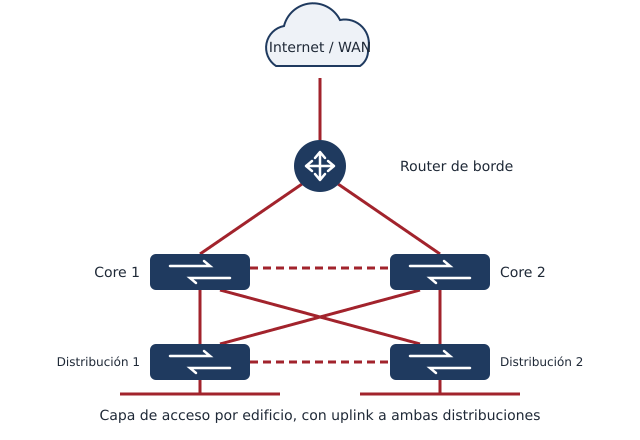
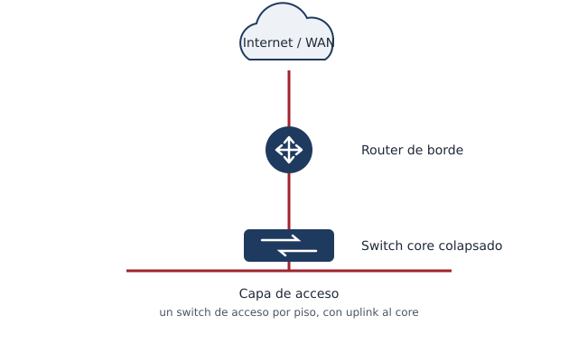
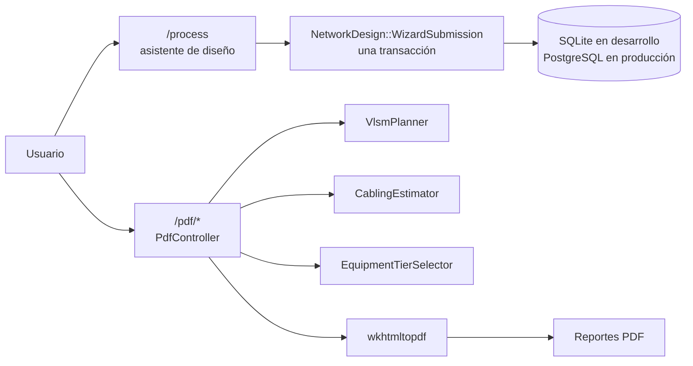
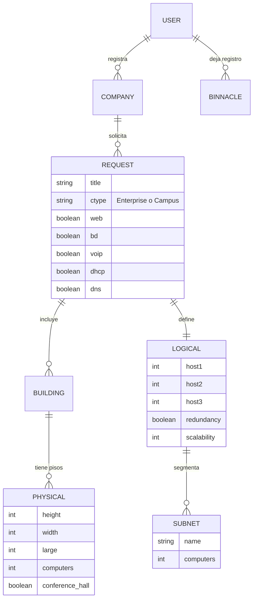

# LDWS Rails: diseño automatizado de redes LAN multinivel (Universidad Distrital)

[](https://github.com/KevinAndrey96/rails-udistrital-ldws-lan-network-design-system/actions/workflows/ci.yml)
[](https://rubyonrails.org/)
[](https://www.ruby-lang.org/)
[](docker-compose.yml)
[](https://www.udistrital.edu.co/)

**LDWS** (*LAN Design Web System*) es una aplicación web en **Ruby on Rails** que guía el diseño de una red de área local para una organización de varios edificios y pisos. Con los datos de la empresa, los servicios que necesita y las dimensiones de cada piso, genera el **direccionamiento IP con VLSM**, la **topología Enterprise o Campus**, el **plano de puestos de trabajo**, la **estimación de cableado estructurado**, los **scripts de configuración de switches y routers** y una **cotización en tres perfiles**, todo exportado a **PDF**.

Proyecto de grado *"Modelo para el diseño de redes en entornos LAN basado en un sistema multinivel"*, Universidad Distrital Francisco José de Caldas, Bogotá, 2018.

> **Dos ediciones del mismo modelo.** Esta es la edición en **Ruby on Rails**. La edición original en **PHP con Phalcon** vive en [ldws-ud](https://github.com/KevinAndrey96/ldws-ud). Ambas implementan la misma metodología; esta conserva su historial de desarrollo de 2018 y una modernización de 2026 documentada commit a commit.

---

## Qué produce

El asistente (`/process`) recorre cuatro pasos: empresa, solicitud y servicios, edificios y pisos, y diseño lógico. Desde el panel de cada solicitud se descargan nueve reportes:

| Reporte | Contenido |
| :--- | :--- |
| Datos básicos de la empresa | Resumen de la organización, equipos y servidores requeridos |
| Direccionamiento | Plan VLSM actual y con crecimiento proyectado |
| Scripts de switches | VLANs, puertos de acceso, STP y seguridad por piso |
| Scripts de routers | Enrutamiento entre VLANs con 802.1Q, DHCP, RIP y seguridad |
| Topología | Plano de cada piso con rack, switch, puestos y sala de conferencias |
| Diagramas de red (2) | Topología lógica y switches de acceso por piso |
| Cotización | Perfiles económico, estándar y óptimo con metraje de cable y canaleta |
| Reporte final | Todo lo anterior en un solo documento |

<p align="center">
  
  
</p>

---

## Arquitectura



La lógica de ingeniería vive en servicios Ruby puros dentro de `app/services/network_design/`. No dependen de Rails y tienen su propia suite de pruebas, que corre en cualquier versión moderna de Ruby:

| Servicio | Responsabilidad |
| :--- | :--- |
| `VlsmPlanner` | Asigna subredes de mayor a menor, alinea cada bloque a su tamaño y calcula la ruta resumen |
| `CablingEstimator` | Metros de cable UTP y de canaleta por piso según la ubicación de cada puesto |
| `EquipmentTierSelector` | Gama de cada equipo (1 a 3) para los perfiles de cotización según el inventario |
| `WizardSubmission` | Persiste el asistente completo: hasta 10 edificios, 50 pisos y 10 subredes |

---

## Direccionamiento VLSM

Cada subred pide `hosts` direcciones utilizables. El planificador elige el prefijo más largo que las contiene, ordena las subredes de mayor a menor (desempate por nombre, para que el resultado sea determinista) y alinea cada bloque a su tamaño:

$$\text{prefijo} = 32 - \left\lceil \log_2(\text{hosts} + 2) \right\rceil, \qquad \text{prefijo} \le 30$$

Los computadores que no pertenecen a ninguna subred se agrupan en una subred `default`. El plan con crecimiento aplica el porcentaje de escalabilidad del diseño: \( \text{hosts}' = \text{hosts} + \lfloor \text{hosts} \cdot \text{escalabilidad} / 100 \rfloor \).

Ejemplo con red base `192.168.10.0` (salida real del planificador):

| Subred | Hosts pedidos | Red | Máscara | Primer host | Último host | Broadcast |
| :--- | ---: | :--- | :--- | :--- | :--- | :--- |
| ventas | 50 | `192.168.10.0/26` | `255.255.255.192` | `.1` | `.62` | `.63` |
| sistemas | 20 | `192.168.10.64/27` | `255.255.255.224` | `.65` | `.94` | `.95` |
| default | 10 | `192.168.10.96/28` | `255.255.255.240` | `.97` | `.110` | `.111` |

Ruta resumen para el core: `192.168.10.0/25`.

## Cableado estructurado

Cada piso se modela como una cuadrícula de `largo × ancho` metros con el rack en la esquina. Los puestos ocupan las filas pares, dejando la columna 0 como pasillo. Para un puesto en la fila \(r\) y la columna \(c\), con altura de piso \(h\):

$$L_{\text{puesto}} = \underbrace{0.5 + 2h + 2}_{\text{bajante y holguras}} + \begin{cases} c + 1 & r = 0 \\ r + c + 2 & r > 0 \end{cases}$$

Cada piso suma además un enlace troncal \(0.5 + 2h + 2\) y, si tiene sala de conferencias, \(2h + \text{ancho} + \text{largo} + 4\). La canaleta suma 1 m por piso, 1 m por puesto de la primera fila y \(r + 2\) m por cada puesto de las demás.

## Perfiles de cotización

| Perfil | Gama preferida | Alternativas si no hay inventario |
| :--- | :---: | :--- |
| Económico | 1 | 2, luego 3 |
| Estándar | 2 | 3, luego 1 |
| Óptimo | 3 | 2, luego 1 |

---

## Modelo de datos



El inventario (`Equipment`, `Switch`, `Port`, `TheSwitch`, `Cable`) alimenta la cotización y la selección de switches de acceso y core.

---

## Ejecutar con Docker

```bash
git clone https://github.com/KevinAndrey96/rails-udistrital-ldws-lan-network-design-system.git
cd rails-udistrital-ldws-lan-network-design-system

LDWS_ADMIN_PASSWORD='elige-una-clave' docker compose up --build
```

La aplicación queda en <http://localhost:3000>. El primer arranque crea la base de datos y carga el inventario de ejemplo y un administrador `admin@ldws.local` con la clave indicada. Si no se indica ninguna, se genera una aleatoria y se imprime en el log.

La configuración se lee del entorno; [`.env.example`](.env.example) documenta todas las variables (`SECRET_KEY_BASE`, base de datos de producción, SMTP y administrador inicial). El repositorio no contiene credenciales.

## Pruebas

```bash
# Servicios de dominio, en cualquier Ruby moderno y sin dependencias
ruby -Itest -e 'Dir["test/services/**/*_test.rb"].sort.each { |file| require "./#{file}" }'

# Suite completa de Rails dentro de la imagen (genera cada PDF con wkhtmltopdf)
docker build -t ldws-rails .
docker run --rm -e RAILS_ENV=test --entrypoint sh ldws-rails -c "bundle exec rake db:schema:load test"
```

La integración continua ejecuta ambas suites y una prueba de arranque del contenedor en cada push.

---

## Modernización 2026

El código de 2018 dependía de servicios que ya no existen y tenía fallos que el uso real no había expuesto. Cada corrección es un commit independiente:

| Problema en la versión 2018 | Corrección |
| :--- | :--- |
| El direccionamiento dependía de una API VLSM externa que dejó de existir | Planificador VLSM nativo con 13 pruebas |
| Los diagramas apuntaban a un host caído y wkhtmltopdf se bloqueaba esperando las imágenes | Topologías e íconos del plano como SVG locales |
| `secret_key_base`, claves de Devise y usuarios con clave `123456` estaban en el repositorio | Configuración por variables de entorno y purga del historial |
| El rol Admin solo ocultaba enlaces: cualquier usuario podía asignarse el rol, y varios módulos no pedían sesión | Autorización en el servidor y acceso a cada diseño solo para su dueño |
| El navegador generaba las llaves primarias con `Math.random()` y nada corría en transacción | El asistente se guarda en una transacción y la base de datos asigna los ids |
| Editar un diseño reemplazaba la llave del diseño lógico y dejaba subredes huérfanas | La edición conserva la identidad y reemplaza las subredes del diseño |
| Una segunda solicitud para la misma empresa perdía el tipo de diseño | Se guarda el tipo Enterprise o Campus |
| Los reportes mostraban la primera solicitud de la empresa en lugar de la elegida | Cada reporte carga la solicitud pedida |
| La canaleta solo contaba el último edificio | Se suma la de todos los pisos |
| Rails 4.2.5 no arranca en un Ruby actual | Rails 4.2.11.3 sobre Ruby 2.6 en Docker |
| Las pruebas generadas por el scaffold no coincidían con el esquema | 50 pruebas de integración y de dominio |

---

## Estructura

```
app/
  controllers/        asistente, panel, reportes PDF e inventario
  services/
    network_design/   VlsmPlanner, CablingEstimator, EquipmentTierSelector, WizardSubmission
  views/pdf/          plantillas de los nueve reportes
  assets/images/      topologías y plano de piso en SVG
db/seeds.rb           inventario de ejemplo y administrador inicial
test/
  services/           pruebas de dominio sin Rails
  integration/        asistente, autorización, reportes PDF
Dockerfile, docker-compose.yml, .github/workflows/ci.yml
```

## Créditos

Desarrollado por **Kevin Andrey Herrera Silva** como proyecto de grado en la Universidad Distrital Francisco José de Caldas (2018), y modernizado en 2026.
